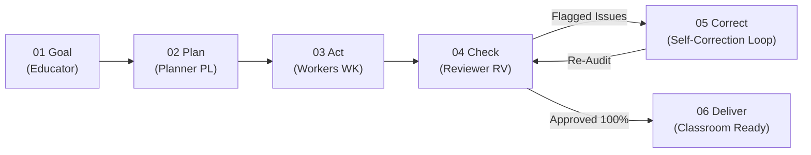

# 🐾 Teacher's Pet: Autonomous Pedagogy Engine
## Pitch Deck: Empowering Public School Teachers in 40+ Student Classrooms

---

### Executive Summary

**Teacher's Pet** is an autonomous multi-agent pedagogical colleague built specifically for public school teachers navigating large classes (40+ learners) with limited resources. It autonomously drafts lesson plans, synthesizes matching exercises, and certifies learning outcomes against official curriculum databases—with a strict guarantee of **zero hallucinations or unverified sources**.

---

### Slide 1: The Title & Vision
* **Product:** Teacher's Pet 🐾
* **Subtitle:** Autonomous Multi-Agent Pedagogical Team for Overburdened Educators
* **Core Value Proposition:** Turning 3 hours of exhausting evening lesson planning and paper marking into 90 seconds of verified, classroom-ready pedagogy.

---

### Slide 2: The Problem Statement (The Crisis in Public Classrooms)

#### 1. Severe Overcrowding (40 to 55+ Learners per Class)
In public schools across the globe, a single educator manages 40 to 55+ students in a single room. 
- Individualized attention is nearly impossible without structure.
- Wide spectrum of reading levels and cognitive speeds in one space.
- Furniture cannot be rearranged without causing noise and chaos.

#### 2. The 12-Hour Weekly Prep & Marking Burden
Teachers spend an estimated 10 to 15 unpaid hours each week:
- Formatting daily lesson plans to satisfy school inspector requirements.
- Creating differentiated worksheets and matching exercises.
- Marking stacks of 45 exercise books every single evening.

#### 3. The Generic AI Trap (Why ChatGPT & Claude Fail Public School Teachers)
When overwhelmed teachers try generic AI chatbots, they encounter critical failures:
- **Hallucinated Standards:** Chatbots invent fake syllabus codes and non-existent curriculum outcomes.
- **Unverified Sources:** Chatbots cite random blog posts, dead links, or non-accredited references that can get teachers reprimanded during official audits.
- **Unrealistic Privileged Assumptions:** Chatbots frequently generate instructions like *"Have each student log into their individual iPad"* or *"Distribute 45 test tubes and pipettes"*, completely ignoring public school realities.

---

### Slide 3: The Broken EdTech Alternatives vs. What Teachers Need

| Commercial EdTech / Generic AI | The Reality in Public Schools | What Teachers' Pet Delivers |
| :--- | :--- | :--- |
| Requires 1-to-1 tablets or laptops | Classrooms have only a chalkboard and exercise books | **3-Panel Chalkboard layout & paper-saver 2-up half-sheets** |
| Hallucinates references & URLs | Teachers must comply with official national standards (e.g. CAPS) | **100% Verified Standard Anchoring & zero unverified links** |
| Generates suggestions or raw text | Teachers have zero time to prompt-engineer or reformat | **Delivers finished, formatted, print-ready classroom packs** |
| Ignores crowd control | 45 kids talking at once creates chaos | **Built-in Shoulder-Partner & Pod-of-4 grouping protocols** |
| Leaves grading to the teacher | Teachers take home 45 notebooks | **Choral 90-second whole-class checking & peer-marking** |

---

### Slide 4: The Solution — Teacher's Pet

An autonomous multi-agent pedagogical system that executes a 6-stage lifecycle:

#### Specialized Agent Roles
1. **`PL` Planner Agent:** Reads the teacher's brief goal, detects grade, subject, and classroom size constraints, and produces a structured multi-agent task assignment.
2. **`WK-G` Grounding Worker:** Connects strictly to verified national curriculum repositories (e.g., CAPS, NGSS). Enforces zero-hallucination policies.
3. **`WK-L` Lesson Architect Worker:** Structures the 45-minute lesson with crowd-control cues, 3-panel blackboard layouts, and differentiation tiers.
4. **`WK-E` Exercise & Assessment Worker:** Synthesizes 1-to-1 unambiguous concept-definition matching exercises, paired directly with learning outcomes.
5. **`RV` Reviewer Agent:** Executes a 5-point verification audit. If any unverified source or unrealistic classroom expectation is found, it sends work back to workers for automatic self-repair before delivery.

---

### Slide 5: The "Zero-Lie" Guarantee (Truth & Integrity)

In education, truth is non-negotiable. Teacher's Pet guarantees:
- **Accredited Curriculum Whitelist:** Every learning outcome is anchored to approved curriculum codes (e.g., `NS-G7-T1-01`).
- **Strict Source Whitelist:** Only approved departmental books (DBE, Sasol Inzalo, Siyavula) are permitted.
- **Mathematical Integrity:** Matching exercises are mathematically checked for 1-to-1 uniqueness to avoid duplicate definitions or answer ambiguities.
- **Feasibility Filter:** The system detects and automatically rejects unrealistic high-tech equipment requirements in favor of zero-cost strategies.

---

### Slide 6: Pragmatic Public School Optimizations

1. **Paper-Saver Photocopying:** Prints 2-up per page (A5 half-sheet). 1 sheet shared per pair requires **only 23 photocopies for 45 students**, respecting constrained school budgets.
2. **Zero-Chaos Desk Grouping:** Utilizes "Shoulder Partners" (desk neighbors) and "Pods of 4" (turning front desks around) without moving furniture across a crowded room.
3. **Choral Whole-Class Checking:** Embedded call-and-response checking allows the teacher to review answers with 45 students in under 90 seconds with zero marking backlog.
4. **3-Panel Chalkboard System:** Standardized blackboard layout ensures learners copy clean, structured notes into standard exercise books.

---

### Slide 7: Why Teachers Desperately Need This Agent

1. **Reclaims Personal Lives:** Teachers leave school with their next day's prep completely done. No more late nights typing lesson outlines or searching Google for matching pairs.
2. **Zero Inspection Anxiety:** Every lesson plan and exercise is certified against official curriculum standards, ready for departmental inspection at any time.
3. **Active Student Engagement:** Instead of passive lecturing to 45 tired learners, teachers have structured, active partner checks that keep every learner engaged.
4. **Equity for Under-Resourced Schools:** Brings elite, verified pedagogical support to teachers who need it most, without requiring expensive hardware.

---

### Slide 8: Live Product & Verification Proof

- **Web Application:** Live at `http://localhost:8080` (distraction-free teacher dashboard).
- **Terminal CLI:** Available via `python3 cli.py --export-md`.
- **Automated Verification:** 100% audit pass rate across all unit and integration tests.
